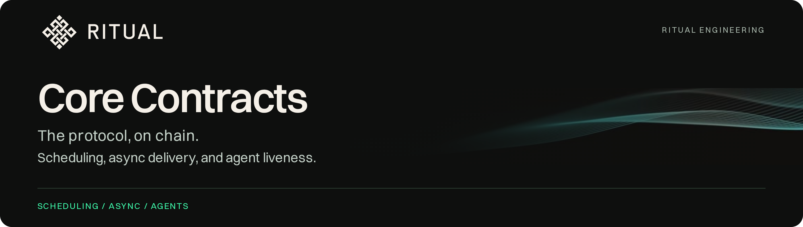

  <picture>
    <source media="(max-width: 600px)" srcset=".github/assets/ritual-header-mobile.png">
    
  </picture>

  
  
  

  <a href="#overview">Overview</a> &middot; <a href="#contracts">Contracts</a> &middot; <a href="#tests">Tests</a> &middot; <a href="#license">License</a>

---

## Overview

These are basically the core five contracts at the center of Ritual's chain features: scheduling, payment, async job tracking, settlement, and agent liveness.

Three reserved system accounts come up throughout, and the node itself sends transactions from them: `0x…fa7e` runs scheduled callbacks, `0x…Fa8e` commits async jobs, `0x…fA9E` settles them.

## Contracts

| Contract | Path | Code lines | Driven by |
| --- | --- | --- | --- |
| Scheduler | [`src/scheduler/Scheduler.sol`](src/scheduler/Scheduler.sol) | 1,686 | `0x…fa7e` |
| RitualWallet | [`src/wallet/RitualWallet.sol`](src/wallet/RitualWallet.sol) | 494 | Scheduler, AsyncDelivery, AsyncJobTracker |
| AsyncJobTracker | [`src/async/AsyncJobTracker.sol`](src/async/AsyncJobTracker.sol) | 1,060 | `0x…Fa8e` |
| AsyncDelivery | [`src/async/AsyncDelivery.sol`](src/async/AsyncDelivery.sol) | 322 | `0x…fA9E` |
| AgentHeartbeat | [`src/heartbeat/AgentHeartbeat.sol`](src/heartbeat/AgentHeartbeat.sol) | 616 | `0x…fa7e` |

The interfaces these contracts import are included alongside them (`IRitualWallet`, `IAsyncJobTracker`, `IAgentHeartbeat`, the scheduler callback/predicate/bridge interfaces, and the TEE registry interfaces), since the structs, enums, and API documentation live there.

## Tests

The repository includes the audit-scope Foundry harness and pinned dependencies. Run `git submodule update --init --recursive`, then `forge test`.

---

## Scheduler

- **What it is.** Contracts use it to register callbacks for future blocks, one-shot or recurring. A single schedule tops out at 256 runs and a 10,000-block span; contracts that need more chain schedules back to back. A system account (`0x…fa7e`) makes the actual calls.
- **How it works.** Each run goes through `execute()`, which re-checks the preconditions before touching anything: the run is due, it hasn't already executed, it's still inside its TTL window, the base fee fits under the call's cap, and any predicate contract the call named still returns true. It debits the sponsor's RitualWallet for the worst case up front and refunds unused gas after the callback returns. If the sponsor can't pay, the whole schedule gets evicted; if the base fee just spiked past the cap, the run is skipped and retried.
- **Some design notes.** There's no lifetime escrow; solvency is checked at each run, and eviction removes the schedules of sponsors who can't pay. Completion is tracked in a bitmap (`executedBitmap`) so runs can finish out of order, which overlapping TTL windows and async handoffs make normal. A failed refund reverts the whole block, because payment accounting is treated as consensus-critical.

## RitualWallet

- **What it is.** It holds user funds, and every protocol payment comes out of it. Each account has an available and a reserved balance, and every async job gets an escrow keyed by its jobId.
- **How it works.** It runs two payment paths. For scheduled calls, the Scheduler debits it just-in-time through `deductScheduledExecutionFeesFrom`, which returns 0 instead of reverting when the sponsor can't pay. Async jobs instead follow `reserveFrom` → `settle` → `expire`. Settlement credits recipients' wallet balances instead of transferring RITUAL, and once `expiryBlock` passes, anyone can call `expire()` to return the leftovers to the sponsor.
- **Some design notes.** Only the Scheduler, AsyncDelivery, and AsyncJobTracker can move other people's funds, and all three are fixed in the constructor. Paying in credits instead of transfers removes the reentrancy surface at settlement, so RITUAL only leaves through `withdraw()` and the scheduler debit.

## AsyncJobTracker

- **What it is.** It tracks off-chain work that's still in flight: HTTP calls, LLM runs, media generation, agent spawns. Each job keeps an entry here until an executor finishes it or it expires.
- **How it works.** The commitment account (`0x…Fa8e`) files jobs through `addJobAndReserve`, which checks the executor against the TEE registry, enforces input ≤ 10KB and TTL ≤ 500 blocks, and locks wallet escrow in the same call. It stores only keccak hashes of the inputs; the full bytes come back as calldata and get re-hashed at every later step. Jobs are bucketed by expiry block so cleanup stays cheap.
- **Some design notes.** All of its structures are bounded: 10k pending jobs, 25 removals per cleanup pass, O(1) index updates via swap-and-pop. It assumes reth already validated the commitment before filing it. The delivery-fee parsing mirrors reth's ABI layouts at hardcoded byte offsets, and the two are only kept in sync by hand.

## AsyncDelivery

- **What it is.** It pays out finished async jobs and removes them from the tracker. The settlement account (`0x…fA9E`) is its only caller, and it's the only contract allowed to touch the tracker's settlement functions.
- **How it works.** `settle()` pays the executor, the commitment validator, and `block.coinbase` out of escrow, and a single-phase job is done at that point. Jobs whose results arrive later (proofs, generated media, agent output) settle in two phases, and the second one is `deliver()`: it runs the requester's callback under a metered gas budget, measures what got used, and refunds the rest to the sponsor. A reverting callback doesn't block payment.
- **Some design notes.** The sponsor pre-funds a worst-case callback envelope, so a requester can't withhold payment by reverting. Payment addresses resolve from the registry at settlement time rather than from the commitment, which lets operators rotate addresses mid-job but means registry state has to be trusted at that moment. A failed refund reverts the block, same rule as the Scheduler.

## AgentHeartbeat

- **What it is.** It tracks liveness for persistent agents, keyed by agentId. Executor machines crash, so the protocol needs an on-chain record of which agents are still running and a path to restart the ones that aren't.
- **How it works.** `claim()` needs a registered executor's cosignature and at least 0.1 RITUAL of native balance on the agent's address (`MIN_BALANCE`; RitualWallet funds don't count). Each heartbeat stores a manifest CID as the recovery checkpoint. Once `lastHeartbeat + timeout` passes, the system account vacates the slot and can call `reviveAgent`, which relaunches the agent from its last CID through the `0x0820` precompile. Every attempt increments `revivalAttempts`; once the count reaches `MAX_REVIVAL_ATTEMPTS`, the sweep stops retrying and drops the agent from tracking. A successful claim resets the counter.
- **Some design notes.** Revival is a fresh launch rather than a state restore, so the slot stays vacant until the new instance claims it. The revival call itself is fire-and-forget: success is proven by a later fresh claim, not by the call's return value. A per-agent nonce bumps on every claim, heartbeat, and vacate, which prevents signature replay. Sweeps process at most 100 agents per call.

---

## License

The source contracts are licensed under the Clear BSD License (`BSD-3-Clause-Clear`).

---

  <picture>
    <source media="(prefers-reduced-motion: reduce)" srcset=".github/assets/ritual-threads-still.jpg">
    
  </picture>

